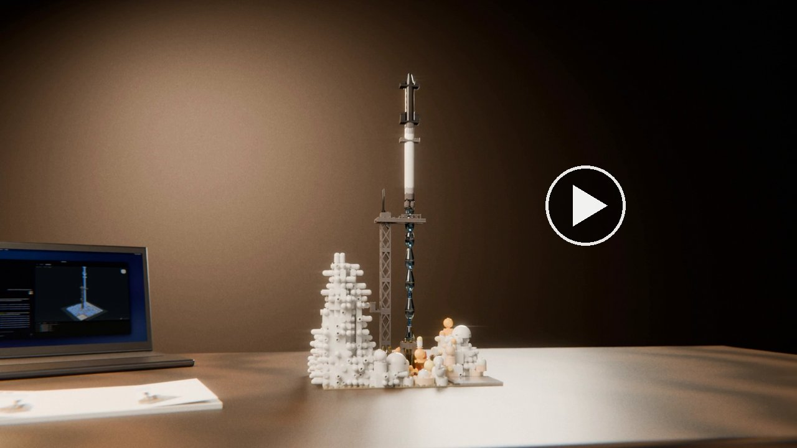
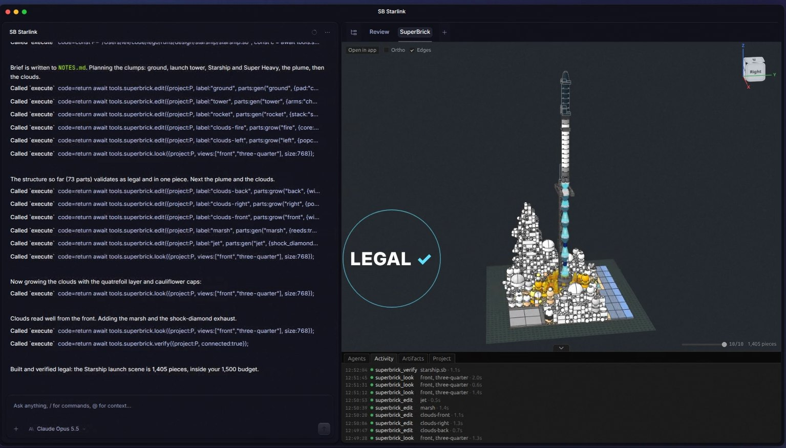

# SuperBrick for opencode

Watch an agent build LEGO models in [opencode](https://opencode.ai) Desktop. This plugin puts a
live 3D view of the agent's [SuperBrick](https://github.com/levtechs/SuperBrick) project, its
tool activity and its proposals beside the chat, so you can review and accept its work without
leaving opencode.

<!-- demo-video -->
<p align="center">
  <a href="https://cdn.jsdelivr.net/gh/levtechs/opencode-superbrick@master/docs/superbrick-opencode-demo.mp4">
    
  </a>
</p>
<!-- /demo-video -->



> **Requires the SuperBrick app.** The agent builds through SuperBrick's MCP server, and this
> plugin reads the same `.sb` project. [Download SuperBrick](https://github.com/levtechs/SuperBrick/releases/latest)
> first and connect its MCP server to opencode (`sb mcp --user <agent name>`).

## What it does

- **Follows the agent.** The panel connects itself to the newest `.sb` project the agent's
  tools mention, or pick one with **Project**.
- **3D view.** Drag to orbit, right-drag to pan, scroll to zoom; a view cube jumps to the
  standard views. **Accepted** shows only accepted pieces, **Builder** adds the agent's open
  proposals, and **Generated** previews an `.ldr`/`.mpd` the agent wrote but hasn't proposed.
- **Proposals.** Accept, reject (with a note the agent sees), or **Ask** the agent about one in
  the chat. Accepting a proposal also accepts the ones it builds on.
- **Activity.** Live SuperBrick tool calls from the agent and its sub-agents, with timings,
  plus the renders and models it produced.
- **Open in app** opens the project in SuperBrick for real editing.

This is a viewer that uses Three.js and the LDraw library, so it can look a little different
from SuperBrick, and it can't edit pieces. A clean picture isn't proof that the build is
legal; SuperBrick's `verify` is the checker.

## Install

Needs opencode Desktop **2.2.5** (its experimental GUI plugin API), Node 20.19+ or 22.12+,
SuperBrick, and Python 3.

```sh
git clone https://github.com/levtechs/opencode-superbrick
cd opencode-superbrick
ELECTRON_SKIP_BINARY_DOWNLOAD=1 npm ci
npm run build
```

Add the folder to the `plugins` array in `~/.config/opencode/opencode.jsonc`, keeping any
existing entries:

```jsonc
{
  "plugins": ["/absolute/path/to/opencode-superbrick"]
}
```

In a session, open the side panel's **+ → SuperBrick**, or run **SuperBrick: watch build** from
the command palette. **Settings → Extensions → Plugins** turns the panel on or off.

### Settings

- **Builder** is the agent's `sb --user` name (for example `claude`); it picks whose proposals
  you see.
- **Run folder** is optional: a folder to watch for models and renders the agent writes before
  proposing them.
- Settings are kept per opencode session.

Keep projects out of iCloud Drive and other synced folders; the plugin refuses them because
syncing a live SQLite file can corrupt it.

While SuperBrick has the same project open for editing, accept and reject are turned off here.
Close the project in SuperBrick first.

### Environment overrides

`SUPERBRICK_PLUGIN_SB` (the `sb` executable), `SUPERBRICK_PLUGIN_PYTHON`,
`SUPERBRICK_PLUGIN_LIBRARY` (LDraw zip). SuperBrick's own `SB_LDRAW_ZIP`, `BENCH_LDRAW_ZIP`,
`BENCH_LDRAW_EXTRA`, `SB_SUPPORT_DIR` and `SB_NO_LEOCAD` are respected too.

## Development

```sh
npm run check     # type-check
npm test          # build, then unit and integration tests on temporary projects
npm run dev       # rebuild the GUI bundle on change
npm run preview   # browser harness at http://127.0.0.1:4318 with a temporary fixture project
```

Server-side changes need the opencode server plugin reloaded, not just a GUI rebuild.

| File | What |
|---|---|
| `src/server.ts`, `activity.ts`, `rpc.ts` | tool activity, including sub-agent sessions |
| `src/main.ts`, `contract.ts` | desktop main-process IPC, per-session settings, launching SuperBrick |
| `src/backend/project.ts` | short read-only SQLite snapshots of the `.sb` project |
| `src/backend/build.ts` | file watching, exports through `sb`, guarded accept/reject |
| `src/backend/library.ts` | local LDraw zip lookup and MPD packing (no downloads) |
| `src/viewport.ts`, `viewcube.tsx`, `panel.tsx` | the Three.js view and the Solid UI |

Exports of the accepted model run `sb` without `--user`, so they are read-only. The panel's
accept and reject clicks run as the person, with `SB_ALLOW_HUMAN`.
