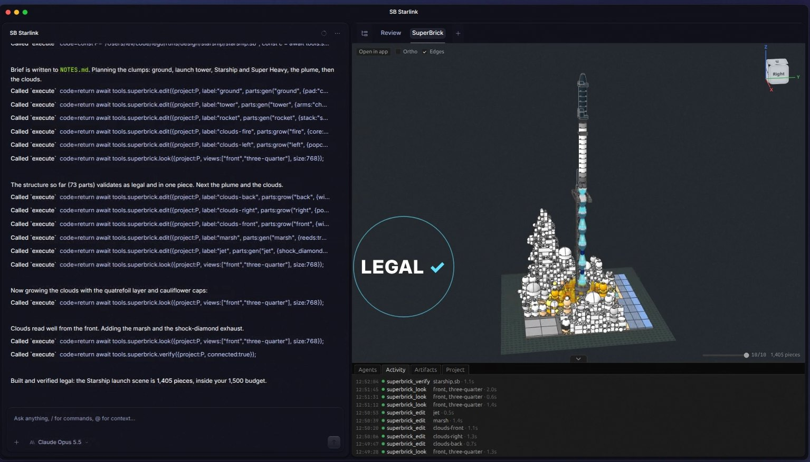
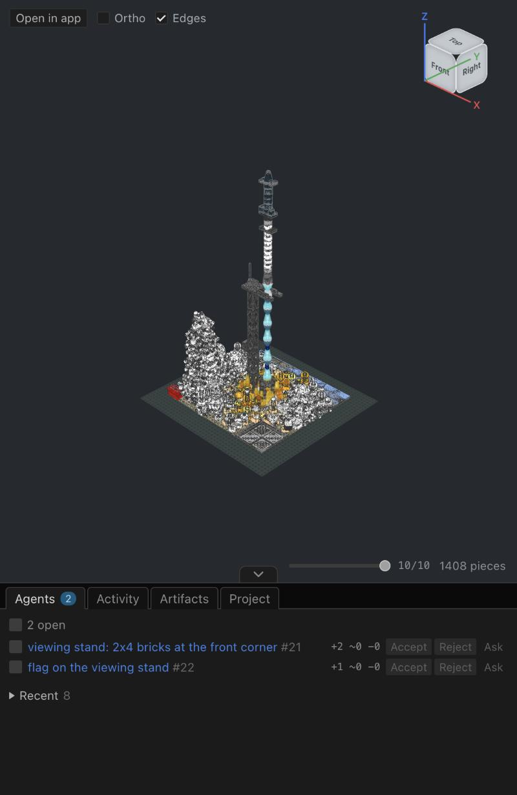
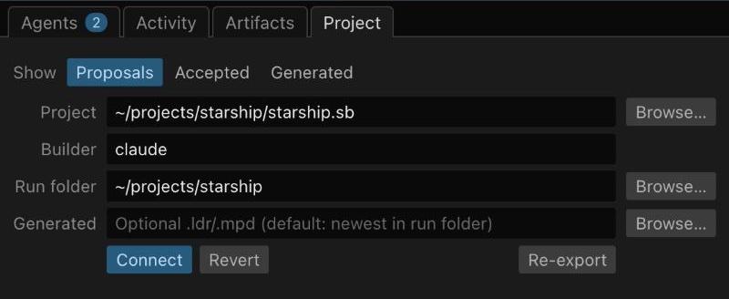

# Features

The panel sits in opencode's side panel, beside the chat. It follows the agent's SuperBrick
project as the agent builds, and lets you review what it proposes.

## It follows the agent

You don't have to point it at anything. When the agent's SuperBrick tools mention a `.sb`
project, the panel connects to the newest one. To watch a different project, pick it on the
**Project** tab.

## 3D view

- **Drag** to orbit, **right-drag** to pan, **scroll** to zoom.
- The **view cube** in the corner jumps to the front, back, side, top and bottom views.
- **Ortho** switches to a flat projection; **Edges** turns part outlines on and off.
- The **step slider** at the bottom plays the build back step by step, with the piece count
  beside it.

The view uses Three.js and the LDraw parts library, so it can look a little different from the
SuperBrick app. It's a viewer: you can't move pieces here.

## Proposals

Every change the agent makes in SuperBrick is a proposal (a draft) until you accept it. The
**Agents** tab lists them with how many pieces each adds, changes and removes.

- **Accept** adds it to your model. Accepting a proposal also accepts the ones it builds on.
- **Reject** throws it away. You can leave a note, and the agent sees it on its next call.
- **Ask** puts a question about that proposal into the chat.
- **Recent** shows what you accepted and rejected before.

Accept and reject are turned off while the same project is open for editing in the SuperBrick
app. Close it there first.

## Activity and artifacts

- **Activity** lists the agent's SuperBrick tool calls as they happen, including calls from its
  sub-agents, with how long each took.
- **Artifacts** collects the renders and model files the agent produced.

## What to show

On the **Project** tab, **Show** picks what the 3D view draws:

- **Proposals:** your accepted model plus the agent's open proposals.
- **Accepted:** only what you have accepted.
- **Generated:** an `.ldr` or `.mpd` file the agent wrote but hasn't proposed yet, such as a
  sketch from a script. By default it's the newest one in the run folder.

The rest of the tab is described in [Install and setup](SETUP.md#settings).

## Open in app

**Open in app** opens the project in SuperBrick, for real editing and for the full set of
checks.

A clean picture isn't proof that a build is legal. SuperBrick's `verify` is the checker.
